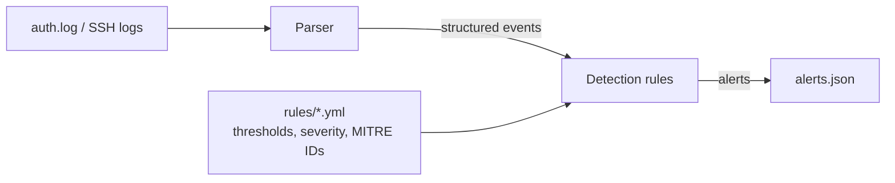

# Log Detection Engine


A Python detection engine that parses Linux authentication logs and flags
attacker behaviour using YAML-configured detection rules mapped to MITRE ATT&CK.
It is tested, linted, security-scanned and containerised in a CI pipeline.

## How it works



1. **Parser** turns raw SSH, sudo and useradd log lines into structured events,
   and skips malformed lines without crashing.
2. **Detection rules** look for attack patterns. Each rule's thresholds,
   severity and MITRE ID live in a YAML file, so rules can be tuned without
   changing code.
3. **Alerts** are written as JSON so other tools (a SIEM, a ticketing system) can use them.

## Detection rules

| # | Rule | Detects | Severity | MITRE ATT&CK |
|---|---|---|---|---|
| 1 | `ssh_brute_force` | More than 5 failed logins from one IP within 60 seconds | High | T1110.001 |
| 2 | `ssh_login_after_failures` | A successful login after 3+ failures from the same IP within 10 minutes | Critical | T1110.001 |
| 3 | `sudo_activity` | Commands run with sudo; high severity for sensitive ones (`/etc/shadow`, `useradd`...) | Low / High | T1548.003 |
| 4 | `password_spraying` | One IP trying 5+ different usernames | Medium | T1110.003 |
| 5 | `new_user_created` | A new local user account (possible persistence) | High | T1136.001 |

Together they cover five stages of an SSH attack:

| Attack stage | Rule |
|---|---|
| Trying many accounts | Rule 4: password spraying |
| Guessing a password | Rule 1: brute force |
| Getting in | Rule 2: login after failures |
| Using admin rights | Rule 3: sudo activity |
| Leaving a way back in | Rule 5: new user created (and Rule 3) |

## Example alert

```json
{
  "rule": "ssh_login_after_failures",
  "severity": "critical",
  "mitre_technique": "T1110.001",
  "ip": "203.0.113.45",
  "user": "root",
  "failed_attempts_before_login": 6,
  "login_time": "Dec 10 10:00:40"
}
```

## Results

**Synthetic attack log** (`samples/generated_attack.log`): an attacker brute-forces
root, logs in, reads `/etc/shadow` and creates a backdoor account; a second attacker
sprays usernames; a normal user mistypes their password and runs an update.
The engine produces exactly the 7 expected alerts and ignores the normal user.

**Real data**: 2,000 SSH log lines from an internet-facing server (LogHub):
- 519 failed logins and 112 invalid-user attempts
- Rule 1 flagged **6** brute-force IPs. The top attacker, `183.62.140.253`,
  made 286 failed logins, 6 of them within 10 seconds
- Rule 4 flagged **4** password-spraying IPs, **X** of which the brute-force rule did not catch ✏️
- Example: one IP tried **X** different usernames ✏️

## Tuning

Detection is a trade-off between catching attacks and creating noise.
Lowering the brute-force threshold from 5 to 2 failures caught extra low-volume
sources in the real data, but also fired on a slow test attacker and would flag
real users who mistype their password a few times. I kept 5 as the default to
balance coverage against alert fatigue. Thresholds live in `rules/*.yml`,
so they can be tuned without code changes.

## Security design

- **Safe YAML loading**: rule files are read with `yaml.safe_load`, which cannot execute code
- **Input validation**: malformed lines, impossible timestamps and invalid characters are skipped, so one bad line cannot crash detection
- **Non-root container**: the Docker image runs as an unprivileged user on a slim base image
- **Read-only evidence**: logs are mounted into the container read-only
- **Pinned dependencies**: Python packages and CI actions are pinned to exact versions
- **Automated checks**: every push runs ruff, bandit, pytest and a trivy image scan

## Quick start

Requires Python 3.10+. Run from the project root.

```bash
python -m pip install -r requirements.txt
python -m detector --input samples/generated_attack.log
```

| Option | Description |
|---|---|
| `--input` | Path to the log file to analyse (required) |
| `--output` | Where to save alerts (default: `alerts.json`) |

Run `python -m detector --help` for details.

## Run with Docker

```bash
docker build -t log-detection-engine .
docker run --rm -v "$PWD/samples:/data:ro" log-detection-engine --input /data/generated_attack.log --output /tmp/alerts.json
```

## Tests and CI

```bash
python -m pip install -r requirements-dev.txt
python -m pytest -v
```

21 tests cover the parser (valid lines and six kinds of malformed input) and each
rule (both when it should fire and when it should stay quiet), plus the full
attack story end to end.

On every push, GitHub Actions runs:
1. **ruff**: code quality
2. **bandit**: security scan of the code
3. **pytest**: all tests
4. **Docker build**, a run of the container on the sample log, and a **trivy** vulnerability scan of the image

## Project structure

```
.github/workflows/ci.yml  # CI pipeline
detector/
  __main__.py             # command-line interface
  parser.py               # turns log lines into structured events
  rules.py                # detection rule logic
rules/                    # rule settings in YAML (thresholds, severity, MITRE IDs)
samples/
  OpenSSH_2k.log          # real SSH logs (LogHub)
  generated_attack.log    # test log with a known expected result
  malformed.log           # deliberately broken lines to test robust parsing
tests/                    # pytest tests
Dockerfile                # container image
requirements.txt          # runtime dependencies
requirements-dev.txt      # development tools (pytest, ruff, bandit)
```

## Limitations and next steps

- Sudo severity uses keyword matching, which an attacker could avoid with tricks
  such as wildcards (`/etc/sh*dow`). A next step is stronger command parsing.
- Brute-force alerts report when the threshold was first crossed, not the attacker's
  peak rate. A next step is adding a `peak_attempts_in_window` field.
- trivy runs in report-only mode. A next step is failing the build on critical findings.
- Only Linux auth logs are supported. Windows Event Logs would be a natural extension.

## Data

- `OpenSSH_2k.log` comes from [LogHub](https://github.com/logpai/loghub) (logpai/loghub).
- `generated_attack.log` and `malformed.log` are synthetic test data using
  documentation IP ranges (203.0.113.0/24, 198.51.100.0/24).